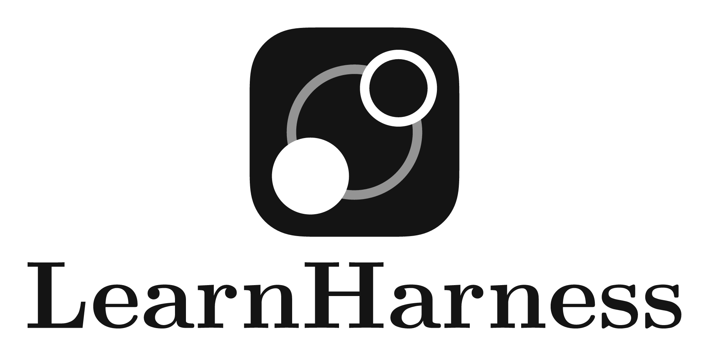
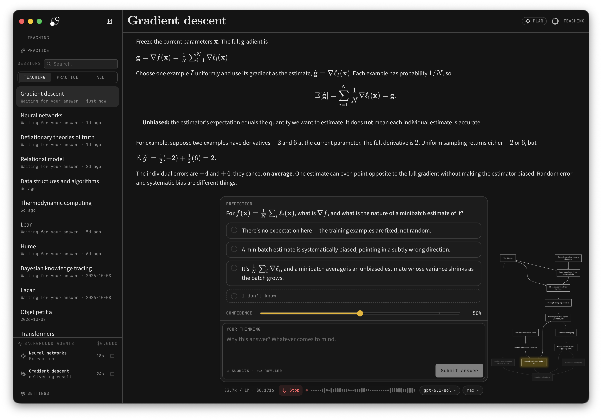
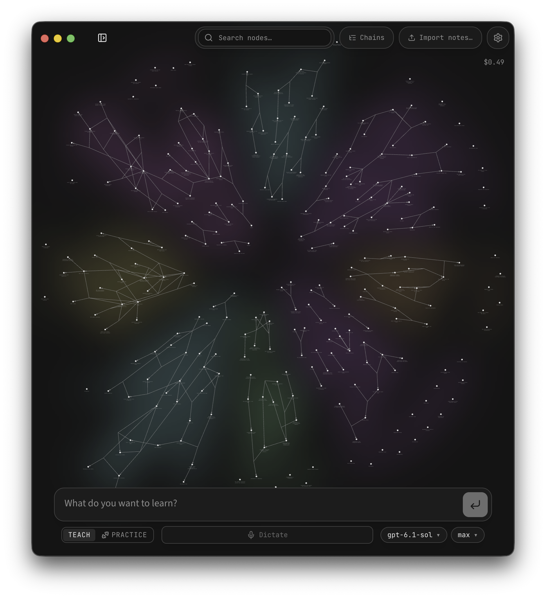

> **非官方简体中文版 / Unofficial Simplified Chinese localization**
>
> 本仓库基于 [LearnHarness](https://github.com/amosblomqvist/learnharness) v0.6.1，原作者 **Amos Blomqvist**。本分支对界面文案与 AI 教学提示词进行了简体中文汉化；并非官方版本。原项目及本修改版使用 **AGPL-3.0-only** 许可，保留原作者版权声明。汉化修改日期：2026-11-20。
>
> **中文版下载：** [本仓库 Releases](https://github.com/manyu2006131/learnharness-zh/releases)（下文保留的官网及上游下载链接指向英文原版）。
>
> **发布说明：** 此分支使用 GitHub Actions 重新构建 Windows 中文版并检查打包后的更新仓库。构建状态及下载以本仓库 Release 为准；未进行人工安装测试。含真实数据的上游测试目录未公开分发，见 [PUBLICATION-NOTES.md](PUBLICATION-NOTES.md)。
>
> **已发布版本：** `v0.6.1-zh.1` 的 Windows 安装包已在 GitHub Actions 中重新构建，并核对包内更新地址为 `manyu2006131/learnharness-zh`。已通过构建、运行时冒烟检查和附件 SHA-256 校验；未进行人工安装或完整功能测试。

---

<p align="center">
  <picture>
    <source media="(prefers-color-scheme: dark)" srcset="docs/assets/lh_banner_dark.png">
    <source media="(prefers-color-scheme: light)" srcset="docs/assets/lh_banner_light.png">
    
  </picture>
</p>

<p align="center"><strong>An agent harness for learning.</strong></p>

<p align="center">
  <a href="https://github.com/manyu2006131/learnharness-zh/releases/download/v0.6.1-zh.1/LearnHarness-0.6.1-zh.1-x64-setup.exe">下载 Windows 简体中文版</a> ·
  <a href="#how-it-works">How it works</a> ·
  <a href="docs/README.md">Documentation</a> ·
  <a href="https://github.com/manyu2006131/learnharness-zh/issues">Issues</a> ·
  <a href="https://discord.gg/5tCHHQEB2e">Discord</a>
</p>

LearnHarness uses AI agents to plan and teach lessons from your current understanding to your goal. It builds a detailed picture of what you understand and how you reason. That picture is updated as you learn.

Instead of just giving you an explanation, it uses your answers and thinking to decide what you need next. Teaching builds understanding one reasoning step at a time. Practice makes it usable. A persistent knowledge graph carries it across sessions.



## How it works

1. **Measure.** Before teaching, the agent finds where your understanding ends on each part the lesson depends on. Your answers, confidence, and thinking show it where to start.
2. **Plan.** It works out a dependency map from that starting point to your goal. You can see the plan, and the lesson adapts when your understanding turns out different.
3. **Teach.** Each step builds on something you already understand. You predict, get an explanation, and check your understanding. Confusions are repaired before anything is built on them. The aim is for the goal to feel obviously true, not merely familiar.
4. **Practice.** Separate sessions pose varied problems that require the right knowledge to come to mind without being named first. Problems and hints adapt to your reasoning.

**Think out loud.** The thinking fields let you explain your reasoning, uncertainties, and reactions in your own words. This is how the agent gets a detailed picture rather than just a record of right and wrong answers. You can type or use dictation.

**Bring your files.** In the desktop app, attach PDFs, photos, or any other file with the paperclip, or drag them in. The file stays where it is: the message carries its path, and the agent reads it from there.

The agent can also research questions in the background, create visual explanations, show your own images in the lesson and mark them up with arrows and labels, and build interactive demonstrations.

## Knowledge that carries forward

What you are taught accumulates as propositions and reasoning chains: individual claims and the premises that lead to them. The graph shows this structure, with links back to the source sessions. You can also import notes.

Future teaching sessions can read the graph instead of starting from scratch. Practice sessions can draw their material from it. It stores the ideas and their connections, not ratings of your ability.



## 下载与安装

本仓库当前提供 **Windows x64 非官方简体中文版 v0.6.1-zh.1**。

1. [下载 Windows EXE 安装包](https://github.com/manyu2006131/learnharness-zh/releases/download/v0.6.1-zh.1/LearnHarness-0.6.1-zh.1-x64-setup.exe)。
2. 运行安装包，按提示完成安装。
3. 打开 LearnHarness，在设置中配置模型服务或兼容接口，再选择模型开始学习。使用第三方模型可能产生其服务商收取的费用。
4. 可通过 [SHA256SUMS.txt](https://github.com/manyu2006131/learnharness-zh/releases/download/v0.6.1-zh.1/SHA256SUMS.txt) 核对下载文件完整性。

[发布页面与更新说明](https://github.com/manyu2006131/learnharness-zh/releases/tag/v0.6.1-zh.1) · [对应源码 ZIP](https://github.com/manyu2006131/learnharness-zh/releases/download/v0.6.1-zh.1/LearnHarness-v0.6.1-zh.1-source.zip)

安装包未签名，Windows 可能显示未知发布者或 SmartScreen 提示。当前发布已通过自动构建与运行时冒烟检查；尚未人工验证安装、完整界面操作或全部功能。

本次没有发布 macOS 或 Linux 中文安装包；[原作者官网](https://learnharness.ai)及[上游 Releases](https://github.com/amosblomqvist/learnharness/releases)提供的是原版发行内容。

Choose your models, then start a session with what you want to understand. You can use provider API keys, supported subscription connections in the desktop app, an installed [Claude Code CLI](docs/claude-code.md), or a [custom OpenAI-compatible endpoint](docs/custom-providers.md), including a local model server. Optional dictation and web search use separate service keys. Web research can use a Tavily, Brave, Exa, Firecrawl, or Ollama key in Settings → Providers → Search. Ollama search uses its hosted service, not a local model server.

See [Getting started](docs/getting-started.md) for model setup, dictation, files, and notes imports, and [context, caching, and costs](docs/compaction-accounting.md) for advanced cache preferences.

本次 Windows 中文安装包的内置更新目标已核对为本仓库；未进行端到端升级安装测试。

## Your keys, your data

- **Your keys and models.** No LearnHarness subscription or markup. Billing depends on your provider, CLI configuration, subscription, or local setup. The live cost meter estimates known API costs, not subscription, CLI, or custom-endpoint charges.
- **Local storage.** Your chats, graph, settings, and API keys live on your machine. Learning records are plain files you can inspect.
- **External services.** Models run through your configured providers. Model requests send the context needed for the task; web research and dictation also contact external services. Local storage does not mean offline processing.
- **Inspectable behavior.** System prompts are visible and editable. The app is open source under the AGPL-3.0 license.

## Development and support

```bash
npm ci
npm run plugins:setup
npm run dev        # http://localhost:3000
```

本公开分发已排除上游测试目录，`npm test` 不能直接运行；原因及验证范围见 [PUBLICATION-NOTES.md](PUBLICATION-NOTES.md)。

See the [documentation index](docs/README.md) for all guides, [development](docs/development.md) for setup and checks, [architecture](docs/architecture.md) for the runtime, [keyboard shortcuts](docs/keyboard.md), [themes](docs/themes.md) for the theme file format, and [desktop builds and releases](docs/desktop-release.md).

For trusted local plugins, start with the [authoring guide and capability map](docs/plugin-authoring.md). It links the question, practice-problem, submission, view-context and UI contracts. Use [`examples/plugins/`](examples/plugins/) for small runnable templates, [`plugins/`](plugins/) for feature source projects, and the [host architecture](docs/plugin-architecture.md) for internals.

Questions, bug reports, and feature requests: [GitHub Issues](https://github.com/manyu2006131/learnharness-zh/issues).

Security vulnerabilities: report privately as described in [SECURITY.md](SECURITY.md), not in public issues.

## License

[AGPL-3.0](LICENSE)

The app is free and open forever. If we ever charge for anything, it will be for convenience — managed keys, hosting — never for features you can run locally.
